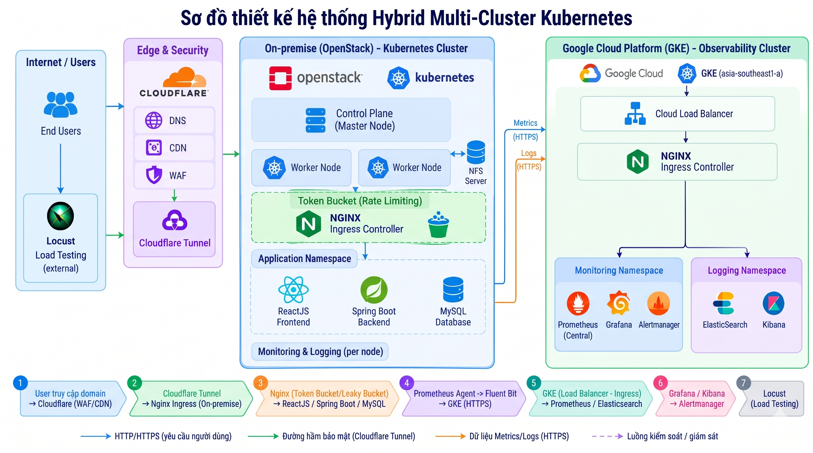
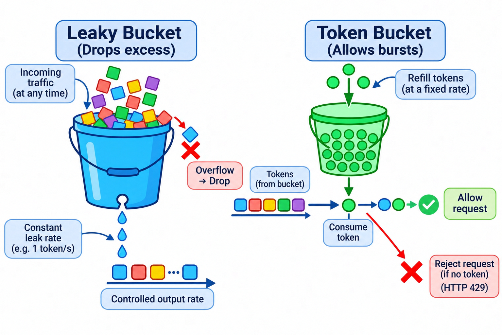

# ☁️ Hybrid-Cloud Kubernetes Platform & Observability Hub

## 📖 Project Overview
This repository contains the declarative Kubernetes manifests and configuration files for a **Hybrid Multi-Cluster Kubernetes architecture** spanning across OpenStack (On-Premise) and Google Cloud Platform (GKE). 

The core objective of this project is to separate the application workloads from the heavy observability stack, ensuring high availability and zero resource contention. It features cross-cluster metric forwarding, centralized logging, and Ingress rate-limiting to protect the system against bursty traffic.

## 🏗️ System Architecture


**Traffic Flow:**
1. **End-users & Load Testing:** Traffic is routed through Cloudflare Edge (WAF/CDN) via a secure Cloudflare Tunnel to the OpenStack workload cluster.
2. **Workload Cluster (OpenStack):** Hosts the Job Portal web application. Nginx Ingress filters and rate-limits traffic using the Token Bucket algorithm.
3. **Observability Hub (GKE):** Prometheus Agents on OpenStack push telemetry data (via Remote Write) to the Central Prometheus Server on GKE. Alertmanager triggers notifications if resource thresholds are breached.


## 🛡️ Rate Limiting & Traffic Control Algorithm


**Algorithm Comparison & Selection:**
1. **Token Bucket (Selected):** Tokens are added to the bucket at a fixed rate. Each incoming request consumes a token to proceed; if the bucket is empty, excess requests are rejected with `HTTP 429 (Too Many Requests)`. This allows short bursts of legitimate traffic while maintaining an average rate limit.
2. **Leaky Bucket (Alternative):** Requests enter a queue and are processed at a constant output rate regardless of incoming traffic spikes, dropping any overflow when the queue is full.
3. **Implementation in Architecture:** Deployed on the **Nginx Ingress Controller** within the **OpenStack Workload Cluster** to protect the Job Portal backend services[cite: 2] from DDoS attacks and sudden load spikes during stress testing.


## 🛠️ Tech Stack
- **Cloud Infrastructure:** Google Kubernetes Engine (GKE), OpenStack.
- **Container Orchestration:** Kubernetes, Docker, Helm, ArgoCD (GitOps).
- **Monitoring & Alerting:** Prometheus (Agent & Central), Grafana, Alertmanager.
- **Logging:** Elasticsearch, Fluent Bit, Kibana (ELK Stack).
- **Networking & Security:** Nginx Ingress Controller, Cloudflare (DNS, WAF, Tunnel).
- **Load Testing:** Locust.

## 🚀 Key Technical Implementations
- **Traffic Policing (Token Bucket Algorithm):** Configured Nginx Ingress with `ngx_http_limit_req_module` (limit-rps: 100, burst: 200) to protect the backend from bursty traffic and simulate HTTP 429 rate-limiting.
- **Cross-Cluster Telemetry (Push-based):** Shifted from traditional pull-based monitoring to a Push-based model using **Prometheus Remote Write** to bypass On-Premise NAT/Firewall restrictions.
- **Automated Incident Alerting:** Integrated Alertmanager with Grafana to trigger email notifications when Pod CPU usage exceeds the 0.4 core threshold (`K8sPodCPUHighUsage`).
- **GitOps Delivery:** Managed cloud resources and configurations declaratively using ArgoCD and Helm charts for reproducible rollouts.

## 📂 Repository Structure

```text
hybrid-cloud-k8s-manifests/
├── Locust/                             # Distributed load testing scenarios & stress profiling scripts
│   └── ...
├── google-cloud/                       # Centralized observability & management cluster on GCP
│   ├── ingress/                        # Cloud Ingress definitions, TLS termination & external routing
│   ├── logging/                        # Centralized logging stack (Elasticsearch, Logstash/Fluent Bit, Kibana)
│   └── monitoring/                     # Central observability hub (Prometheus remote-write endpoint, Grafana, Alertmanager)
├── images/                             # System architecture diagrams and dashboard snapshots
├── openstack-onpremise/                # On-premise workload cluster (OpenStack private cloud tenant)
│   ├── Backend/                        # Spring Boot microservice manifests
│   │   ├── configmap.yaml              # Runtime environment variables and endpoint parameters
│   │   ├── deployment.yaml             # Pod specifications, replicas, and rolling update strategy
│   │   └── service.yaml                # ClusterIP service for internal network discovery
│   ├── Frontend/                       # React.js single-page application manifests
│   │   ├── deployment.yaml             # Nginx-backed web server workload
│   │   └── service.yaml                # Internal routing service
│   ├── Ingress/                        # Edge routing and ingress definitions
│   │   ├── argocd-ingress.yaml         # Ingress rules for ArgoCD web interface
│   │   └── jobportal-ingress.yaml      # Public ingress with TLS termination and traffic routing
│   ├── database/                       # State-managed persistence layer
│   │   ├── pvc.yaml                    # PersistentVolumeClaim binding database storage
│   │   ├── service.yaml                # Headless/ClusterIP service for MySQL routing
│   │   └── statefulset.yaml            # StatefulSet controller ensuring stable network identities
│   ├── storage/                        # Persistent storage provisioning
│   │   └── mysql-pv.yaml               # Cluster PersistentVolume configuration
│   ├── telemetry-agents/               # Cluster observability and metric scraping agents
│   │   ├── metrics-server.yaml         # Core resource metric pipeline powering HPA
│   │   └── prometheus-agent-values.yaml# Helm values for Prometheus agent remote-write telemetry
│   └── kustomization.yaml              # Kustomize entrypoint orchestrating resource trees & image overrides
├── .gitignore                          # Excludes sensitive secrets, local tokens, and ephemeral cache
└── README.md                           # Documentation, architecture blueprint, and GitOps guidelines
